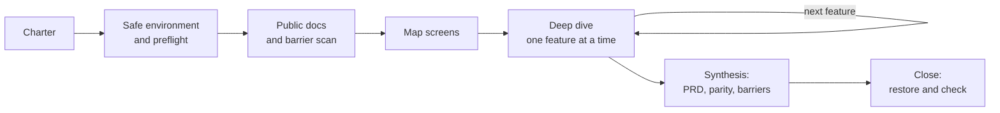

# RES: Reverse Engineering SaaS

[](https://github.com/alextnetto/res/actions/workflows/test.yml)
[](https://github.com/alextnetto/res/releases)
[](LICENSE)

An agent skill for studying a SaaS web product (ClickUp, Pipedrive, any web app) through the browser and turning it into a knowledge base your team can use to rebuild the product and take it to production.

The agent explores the product in a test environment, records every change it makes, writes what it learns to files with evidence for each statement, and lists what could stop the clone from launching.

## What you get

One folder per product, `re-<product>/`:

| Area | Content |
|---|---|
| Inventory | Feature tree, screen catalog with URL patterns, a coverage matrix that works as the queue |
| UX | One file per screen and per component: anatomy, states, interactions, keyboard, accessibility, microcopy |
| Behavior | Business rules as Given/When/Then with evidence, user flows, cross-cutting topics |
| Data | Entities with fields, enums and relations, ER diagram, TypeScript types, permissions matrix, API endpoint shapes |
| Design | Tokens for color, type, spacing, radius, shadow and motion, mapped to the product's CSS variables |
| Production barriers | Integrations that need approval, licenses, certifications, distribution gatekeepers and moats, with severity, lead time and mitigation |
| Clone | Requirements (PRD), parity tests derived from the rules, what to copy, avoid and improve |
| Safety | Environment description, preflight results, change ledger, fixtures |
| Continuity | `STATUS.md`, one log per session, evidence files with dates |
| Handoff | A zip with the knowledge base and `BUILD.md`, a brief any coding agent can follow to build the clone |

## Quickstart

**1. Install.** In a terminal:

```bash
claude plugin marketplace add alextnetto/res
```

```bash
claude plugin install res@res
```

Inside a Claude Code session, the same commands are `/plugin marketplace add alextnetto/res` and `/plugin install res@res`. Start a new session afterwards.

For other agents that read skills from disk, copy the skill folder into the agent's skills directory (`~/.claude/skills/` for Claude Code, for other agents, check where they read skills from):

```bash
git clone https://github.com/alextnetto/res.git && mkdir -p ~/.claude/skills && cp -R res/skills/reverse-engineering-saas ~/.claude/skills/
```

You also need Node.js 22 or later and an agent that can drive a browser: Claude in Chrome, Playwright MCP or Chrome DevTools MCP.

**2. Prepare a safe environment (recommended).** Create a trial account of the product with an email you own, log in to it in a separate Chrome profile, and connect your agent's browser tool to that profile ([how](skills/reverse-engineering-saas/references/tools.md#separate-profile-for-l1)).

Without a trial account, the agent only writes if you ask it to test or to create a test environment. Then it creates a separate workspace or a sandbox container. Otherwise it only observes.

**3. Ask.** In plain language, in any language:

- "Study Pipedrive so my team can rebuild it for the Brazilian market. Use the trial profile."
- "Reverse engineer ClickUp's board and task view. Create a test environment, don't ask me anything."
- "Continue the ClickUp study." The agent resumes from `STATUS.md`.

The agent creates the knowledge base as `re-<product>/` in its working directory, works through the phases below, and runs `check-kb.mjs` before it stops. Start later sessions from the same directory. At the end, the agent sends you `re-<product>-handoff-<date>.zip`: unzip it and give the folder to any coding agent, starting from `BUILD.md`.

## How it works



| Phase | What happens |
|---|---|
| 1 Charter | Goal, scope, priorities and the clone's target market |
| 2 Environment | Pick the safest environment; run a preflight for automations, webhooks and integrations that could fire |
| 3 Recon | Public docs, API reference, pricing, integrations list and terms, read with web fetch; first barrier scan |
| 4 Map | Every screen and route; stack and design tokens |
| 5 Deep dive | One feature at a time: fixtures, states, rules, persistence, network, written to disk before the next feature |
| 6 Synthesis | Data model, design tokens, barriers, PRD, parity tests |
| 7 Close | Restore what changed, update `STATUS.md`, pass `check-kb` |

### Safety model

| Level | Environment | What the agent may change |
|---|---|---|
| L1 | Trial account in a separate browser profile, created by you | Everything except outbound and irreversible actions (messages, invites, billing, API tokens, accepting terms, connecting integrations) |
| L2 | New, empty workspace under your login | Test data and configuration inside that workspace |
| L3 | One sandbox list, project or pipeline inside production | Test data inside the container only |
| L4 | Production, observe only | Nothing |

At every level the agent never sends messages or invites, never assigns or mentions other people, never touches billing, never creates accounts and never types passwords. It treats autosave, read receipts and persistent view changes as writes. Every change goes to `sandbox/ledger.csv` and is restored or removed at the end. When you ask it not to interrupt you, it writes what needs you under "Needs human" in `STATUS.md` and keeps working on the rest.

### What the entries look like

A rule:

```markdown
### R-014 Completing the last open activity prompts for the next one
- Given a deal with exactly one open activity
- When the user marks that activity done
- Then a "Schedule next activity" dialog opens; Cancel closes it and the deal shows a warning icon
- Evidence: [obs EV-031, EV-032]
```

A production barrier:

```markdown
### BR-003 WhatsApp messages need Meta business verification
- Category: permissioned integration
- Blocks: F-014 (WhatsApp notifications)
- Gatekeeper: Meta, WhatsApp Business Platform
- Severity: blocks feature
- Market weight: required to sell
- Lead time and cost: [doc SRC-021]
- Mitigation: start verification in month one; launch with email notifications
- Evidence: [doc SRC-021]
```

`[obs ...]` is something the agent saw, `[net ...]` a network capture, `[doc ...]` public documentation, `[inf]` an inference with an open question.

## FAQ

**Will it change my production data?** Only inside a sandbox you allowed. Every change is recorded in a ledger and, at the end, restored, removed, or listed for you to resolve. Without permission to write, it only observes. Messages, invites, mentions of other people and billing actions are forbidden at every level.

**Does it need my password?** No. The agent never types passwords or creates accounts. You log in, preferably to a trial account in a separate browser profile.

**Which agents and browsers work?** Any agent that reads skills from disk and can drive a browser and run JavaScript in the page. It was written for Claude Code; the method was tested with Claude Code subagents and the page scripts in headless Chromium. Claude in Chrome, Playwright MCP and Chrome DevTools MCP are covered in `references/tools.md`.

**Can I leave it running overnight?** Yes. Tell it not to ask you anything. It records what needs you under "Needs human" in `STATUS.md`, keeps working on the rest, and restores what it changed before it stops.

**Does it work for desktop or mobile apps?** Not well. It needs the DOM and the network. For binaries and Electron internals, use [REA](https://github.com/morluto/rea).

**How do I give the result to my developers?** Ask for the handoff. The agent packs the knowledge base into a zip with `BUILD.md`, a brief that tells a coding agent what to read first, how to turn the rules into tests, and what not to copy. Account details stay out of the zip.

**Is copying a product legal?** That depends on the product's terms and your jurisdiction. RES records the relevant terms clause, rebuilds from behavior instead of copying assets, and flags legal questions for counsel. It does not give legal advice.

## Documentation

| Document | For |
|---|---|
| [SKILL.md](skills/reverse-engineering-saas/SKILL.md) | The rules the agent follows: phases, safety, evidence, close |
| [references/safety.md](skills/reverse-engineering-saas/references/safety.md) | Environment setup, preflight, ledger, teardown, incidents |
| [references/exploration.md](skills/reverse-engineering-saas/references/exploration.md) | Recon, mapping, per-screen checklist, fixtures, rule probing, synthesis |
| [references/barriers.md](skills/reverse-engineering-saas/references/barriers.md) | Production barriers: categories, sources, format |
| [references/knowledge-base.md](skills/reverse-engineering-saas/references/knowledge-base.md) | Knowledge base layout, IDs, evidence, checks |
| [references/extraction.md](skills/reverse-engineering-saas/references/extraction.md) | Page scripts, design tokens, component names, data model, network |
| [references/tools.md](skills/reverse-engineering-saas/references/tools.md) | Browser tools, separate profiles, window size |
| [docs/design.md](docs/design.md) | Design decisions and their reasons |
| [docs/testing.md](docs/testing.md) | How the skill was tested, and how to test changes |
| [docs/comparison-with-rea.md](docs/comparison-with-rea.md) | RES and REA side by side |

## Status

Version 0.2.0. The method was tested with scenario runs on subagents, before and after writing the skill, and the scripts with automated tests. It has not yet been run end to end on a real product, so expect rough edges in the first studies. Reports from real runs are welcome.

How RES compares with [REA](https://github.com/morluto/rea), a technical reverse engineering tool: [docs/comparison-with-rea.md](docs/comparison-with-rea.md).

## Repository layout

```
skills/reverse-engineering-saas/
  SKILL.md               Rules and workflow (what the agent reads first)
  references/            Safety, exploration method, barriers, KB format, extraction, browser tools
  templates/             Knowledge base scaffold and artifact templates
  scripts/init-kb.mjs    Creates a knowledge base
  scripts/check-kb.mjs   Validates IDs, references, evidence, ledger and status
  scripts/pack-kb.mjs    Packs the knowledge base and BUILD.md into a handoff zip
  scripts/page/          Browser scripts: inventory, tokens, api-shapes, mask, annotate
docs/                    Design decisions, test protocol, comparison with REA
tests/                   Automated tests for the scripts
```

## Responsible use

Use RES only on accounts you own or are authorized to examine. Read the product's terms: many forbid reverse engineering or competing use, and that decision is yours. Rebuild from observed behavior; do not copy code, icons, illustrations, logos or long text. The barrier analysis is research, not legal advice.

## Contributing

See [CONTRIBUTING.md](CONTRIBUTING.md). Reports from real studies are the most useful contribution: open a [study report](https://github.com/alextnetto/res/issues/new?template=study_report.yml). Security problems go through [SECURITY.md](SECURITY.md).

## License

[MIT](LICENSE)
